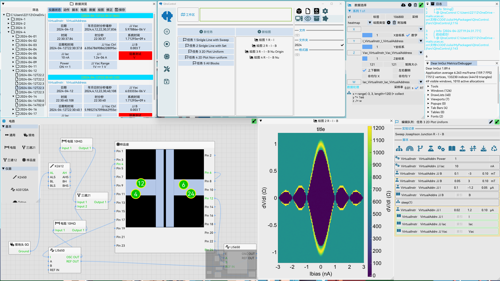
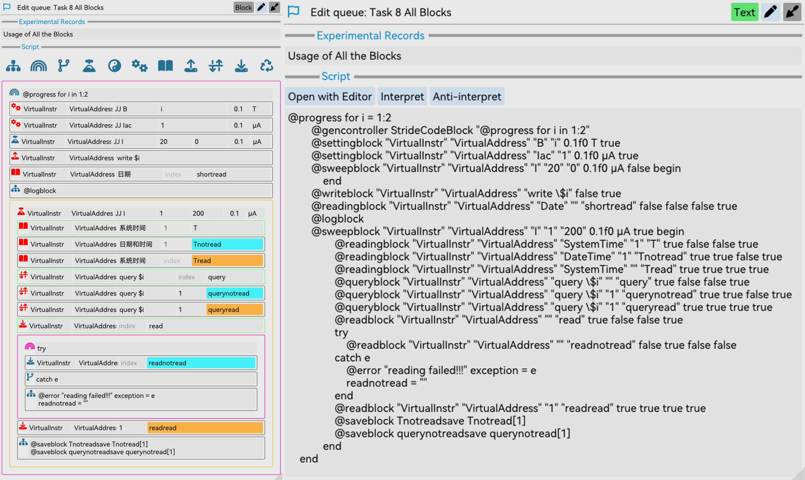
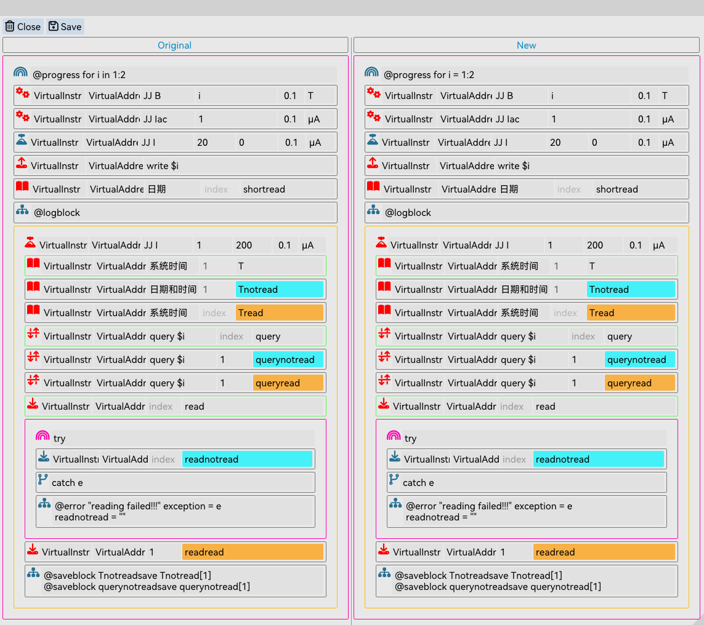

# QInsControl

<!-- [](https://FaresX.github.io/QInsControl.jl/stable/) -->
[](https://FaresX.github.io/QInsControl.jl/dev/)
[](https://github.com/FaresX/QInsControl.jl/actions/workflows/CI.yml?query=branch%3Amaster)
[](https://codecov.io/gh/FaresX/QInsControl.jl)

QInsControl is designed for instrument control and data acquiring. It talks to instruments through
NI-VISA, raw TCP/IP sockets, serial ports, the ISOBUS and the QIC protocol, and provides a friendly
dockable GUI, a flexible block/text script system and a built-in AI assistant to keep both the
convenience and the universality.
See [docs](https://FaresX.github.io/QInsControl.jl/dev/) here or
视频【QInsControl.jl 开源的可编程仪器控制和数据采集工具】 https://www.bilibili.com/video/BV1Y2421N75d/?share_source=copy_web&vd_source=9bb5f2e2197b605d0d141ae8f55c67c7

## install

Julia ≥ 1.10 is required. NI-VISA is only needed for VISA instruments (GPIB, USBTMC, VXI-11, ...);
raw TCP/IP socket and serial-port instruments work without it.

```
julia> ]
(@v1.10) pkg> add https://github.com/FaresX/QInsControl.jl.git
```

Or download a ready-to-run executable from the
[releases page](https://github.com/FaresX/QInsControl.jl/releases), which is a quicker taste.

## usage

```julia
using QInsControl
QInsControl.start()
```

VISA address: `GPIB0::5::INSTR` (standard VISA resource name)
TCPIP socket address: TCPSOCKET::127.0.0.1::8080 [TCPSOCKET::**ip**::**port**]  
serial port address: SERIAL::COM1 [SERIAL::**port**]  
ISOBUS address: ASRL1::INSTR::ISOBUS::1 or SERIAL::COM1::ISOBUS::1 [**bus address**::ISOBUS::**port**]  
virtual instrument: VirtualAddress (no hardware needed, for trying things out)

Besides, two QInsControl instances can communicate with each other. It is possible to use QInsControl
as a monitor to log the instruments' status. For the server end, you have to run the server first
(Server Monitor). As for the client end, you can add the server as adding a new instrument to
communicate with the instruments that are connected to the server.  
QIC address: TCPSOCKET::127.0.0.1::6060::QIC::SERIAL::COM1 [**server**::QIC::**instrument**]

## features

- **Instrument control** — auto-detection of connected instruments, register-defined quantities
  (sweep / set / read) with units, optional values and timeouts; sweep / set / read buttons with
  background auto-refresh and multi-threaded instrument I/O.
- **Data acquiring** — a drag-and-drop task tree running block or text scripts with progress bars,
  pause / continue / interrupt, timestamped autosave and automatic file splitting.
- **Circuit recorder** — a node editor to record the measurement configuration, with undo / redo.
- **Plotting** — GLMakie-powered plots with configurable data selection, real-time updating during
  a run and user-defined data processing functions.
- **Data reviewing** — a file browser for saved data, a tabbed viewer with CSV export and a batch
  formatter for replaying / exporting data.
- **Custom widgets** — design your own control panels per instrument with gauges, sliders,
  selectors, shapes and images.
- **Remote mode** — QIC client / server between two installations (control & monitor).
- **Web dashboard** — an optional read-only companion frontend in the browser: run status,
  progress and live data pushed from the running task.
- **AI assistant** (experimental) — a built-in chat window that writes task and plot scripts,
  answers questions about the software and your instruments, and operates the software through
  tools.
- **UI** — dockable windows, fully editable themes / styles / fonts / wallpapers, toast
  notifications, English and 中文 interface.

## example


A simple project file [demo.daq](example) is in the example folder, which gives some ideas to write
your own scripts.

## scripts

Block mode and text mode can be changed from each other. Block mode is better for selecting
instruments, addresses and quantities and some more useful functions. Text mode is better for
reading and copying codes. Only block mode is supported to be compiled to executable tasks and run
them. Available blocks: CodeBlock, StrideCodeBlock, BranchBlock, SweepBlock, FreeSweepBlock,
SettingBlock, ReadingBlock, WriteBlock, QueryBlock, ReadBlock and FeedbackBlock.




Plain code in scripts can use the macros `@progress` (progress bar), `@saveblock` (record a
variable) and `@psleep` (interruptible sleep), and the helper functions `logblock()` (snapshot all
instrument states), `newfile("name")` (transparently switch to a new data file mid-run),
`timeaverage(data, τ)` and `isarrived(data, target, δ, τ)` (convergence checks for waiting loops).

## custom widgets

Now it comes to a new feature that anyone could create your own widgets to control the instruments.


## Contributing

See [here](https://github.com/FaresX/QInsControlAssets) to contribute to this package.
