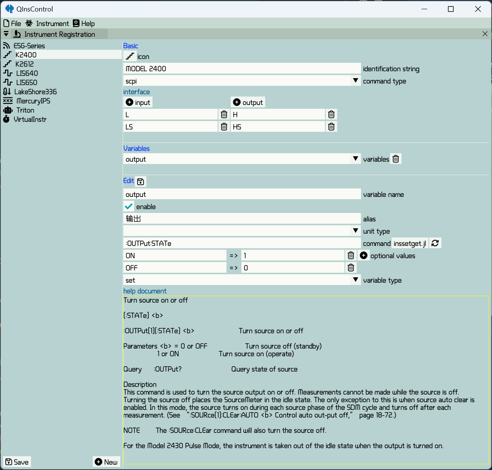

# Instrument register

Instrument register provides a convenient manner to add new instruments, define new quantities and
design custom control widgets to extend the functionality. QInsControl provides a gui to realize it;
you can also directly write the .toml files, which are saved in

```julia
joinpath(pathof(QInsControl), "../../Assets/Confs/")
```

See [here](https://github.com/FaresX/QInsControlDrivers) to share your drivers.



The register window lists all registered instruments on the left. An instrument can be renamed by
double-clicking its name and deleted through its context menu (`VirtualInstr` and `Others` are
built-in and cannot be deleted). The buttons at the bottom save all configurations to the .toml
files and create a new instrument. The right side is a tab bar with one **Configurations** tab and
one **Widget** tab per custom control widget, plus buttons to add a widget, open the configuration
folder and hot-reload the configurations from disk.

# Add a new instrument

It is very easy to add a new instrument by clicking on the button **New**. A well-defined instrument includes an icon, 
an identification string, command type, input and output interface corresponding to the physical ones and several
user-defined quantities. These attributes can be devided into two parts basic one and quantities which are described as
follows.

## Basic Configuration

**icon** : click on the button labeled an icon to open the icon selector and pick a new one.

**identification string** : identification string has to be unique for the editing instrument, which can be obtained by querying the
instrument the command "*IDN?" and pick up the unique parts. It is the pattern that auto-detection
matches against.

**command type** : command type as a hint for auto-generate set and get function can be made sure by looking up the instrument
manual. At present, it surpports tsp (2600 series and so on) and scpi (mostly used). For the other command types, select
the blank option.

**interface** : to add some input and output ports. Each port has a label that shows up in the
instrument widgets, e.g. to document which BNC output corresponds to which quantity.

## Quantity

The variables of the instrument are selected from the combo box, created by typing a new **variable
name** and saved with the **Save** button.

**variable name** : variable name used internally which is better to consist only of English letters.

**alias** : name for convenient identification which is visible to user

**write / read timeout** : per-quantity communication timeouts in seconds used by all set and get
actions of this quantity.

**unit type** : unit type of the obtained data via the specified quantity. When the data are text type, select the blank option.

**command** : the command header for the specified quantity. For scpi, it has to be in the form **Header Value** for a sweepable or settable quantity or the form **Header?** for an only readable quantity. When command or command type is not in the standard form, custom set and get functions can be provided through the **Drivers** button (see below).

**Drivers** : opens the driver file `Assets/ExtraLoad/[Instrument Name].jl` in your text editor.
Functions defined there override the auto-generated ones. When manually adding the set and get
functions, one has to obey the following forms

```julia
function [Instrument Name]_[Quantity Name]_set(instr, val)
end
function [Instrument Name]_[Quantity Name]_get(instr)
    return readvalue
end
```

where the instr parameter is necessary and generally used with the fundamental functions write,
query and read same as in NI VISA. The button next to **Drivers** hot-reloads all the
configurations and driver functions.

**optional values** : This is only suitable for a settable quantity whose settable values are descrete. One can give a key on the left for convenience and corresponds to an available option value. New rows are added with the plus button and removed with the delete button.

**variable type** : It has three options sweep, set and read. Different type has different behavior.

**separator** : when one read returns several values, a separator string (e.g. `,`) can be defined
here together with the number of values per read; leave it empty for single-value reads.

**help document** : a per-quantity help text shown as a tooltip in the instrument controls;
double-click the help text region to edit it.

# Custom widgets

Besides the automatic control buttons, each instrument can define custom widgets — your own panel
layout arranging the quantities of the instrument (and images, shapes, selectors) freely, which is
handy for e.g. a sample holder with a photo, movable pins and the quantities that belong to each
pin.

## creating and editing

Every **Widget** tab of the register window edits one widget. Widgets are created with the plus tab
button, duplicated through the tab's context menu and deleted by closing the tab (a confirmation
dialog appears). Widgets are saved per instrument as `Assets/Widgets/[Instrument Name].toml` and
can be hot-reloaded from disk with the reload button next to the tab bar.

The edit area is a free canvas: elements are placed by dragging (the **Dragging Mode** combo
switches between move and resize), aligned with the **Left / Top / Bottom / Right** buttons, and
the whole panel can show a wallpaper image behind the elements.

## element types

Each element binds to one quantity of the instrument and picks a UI type according to the quantity
type:

- **sweep** quantities: read-only value (`read`), `unit`, `readunit`, step / stop / delay input
  fields (`inputstep`, `inputstop`, `dragdelay`), a `progressbar` showing the sweep progress and
  the `ctrlsweep` start / stop button (with customizable button texts).
- **set** quantities: `read`, `unit`, `readunit`, direct input (`inputset`), combined
  input-and-apply controls (`ctrlset`, `inputctrlset`), and — when optional values are defined for
  the quantity — `combo`, `radio`, `slider`, `vslider` and `toggle` selectors.
- **read** quantities: `read`, `unit`, `readunit` and the analog `readdashboard` gauges (with
  digits variants) driven by the current reading.

Besides quantity elements there are decorative elements — `rect`, `triangle` and `line` shapes and
image elements — for drawing a schematic over the wallpaper. Images support UV cropping, background
and tint colors.

A **selector** (combo / slider / vslider) binds several other elements to its options: switching
the selector shows or hides the bound groups, which turns one widget into e.g. a multi-mode
control panel.

## per-element options

Every element exposes fine-grained options: position and size, frame rounding and border, colors
(text, hint, background, checked, on / off, hovered, active, grab, ...), font size, the number of
dashboard ticks and circle segments, image paths and cropping, and an auto-refresh switch with a
per-element refresh rate that keeps the shown values updated in the background.
