# Workflow

This page walks through a typical session: adding instruments, controlling them, acquiring data,
writing task scripts, plotting and reviewing data.

## The Main Window

QInsControl shows a single main window with a dock space. All other windows (file viewers, data
formatters, instrument buffers, console, logger, ...) are dockable and can be freely rearranged;
the layout is remembered between sessions.

- The left icon rail belongs to the DAQ view: pause / continue, interrupt, auto-refresh
  instruments, open the circuit editor and manage the project.
- The right side is an icon tab bar with three pages: **Instruments**, **Files** and **Help**.
  Each page has its own sub-toolbar, e.g. instrument registration, CPU / server monitors, the
  open file / formatter list, the console, the logger and the about window. The gear icon opens
  the **Preferences** window.
- Notifications (task finished, errors, version updates, ...) appear as toasts in the top-right
  corner.
- `Ctrl+O` opens files and `Ctrl+K` opens a folder.
- The UI language (English / 中文), theme, style, font and wallpaper can be changed in
  **Preferences** and its style editor; changes apply immediately.

## Add Instruments

### auto-detect
One can click on **Auto Search** to auto-detect the available instruments in NI MAX. Each found
address is queried with `*IDN?` and matched against the registered instrument configurations.

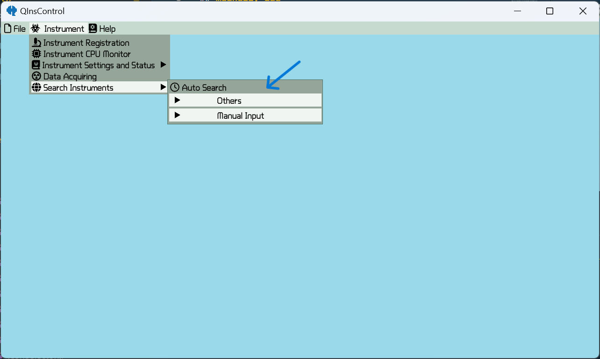

### manually add
Or manually add an instrument through clicking on **Manual Input** after filling the address and clicking on **Add** in
the end. For an instrument that supports TCP/IP protocol, address has to be in the form of **TCPIP::\$IP::\$PORT::SOCKET**.
Raw sockets and serial ports use the `TCPSOCKET::ip::port` and `SERIAL::port` forms; see
[Addresses](index.md) for all supported formats. Right-clicking the input field offers the commonly
used addresses for convenience.

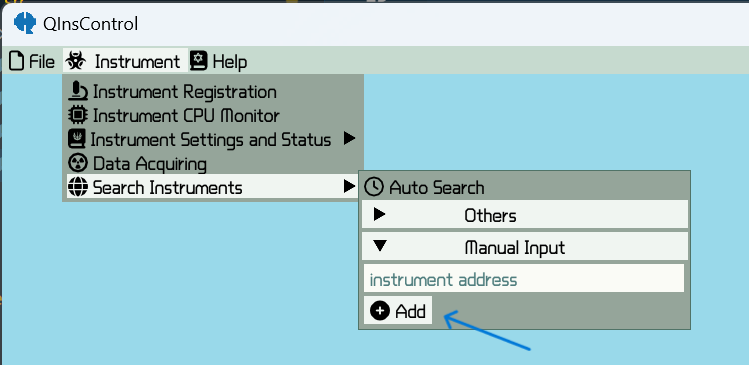

# Control the Instruments

Once adding instruments finishes, one can click **Instrument Settings and Status** to query the status of specific instrument or set it.
The controllable variables are classified by three types: sweep, set, read.

## sweep
For the sweepable variables, it can be swept from the present value to the given value with definite step size and delay.
While sweeping, the button shows a gradient progress overlay and the tooltip reports the current
step, elapsed time and ETA; the sweep can be stopped from the popup or by pressing Enter.

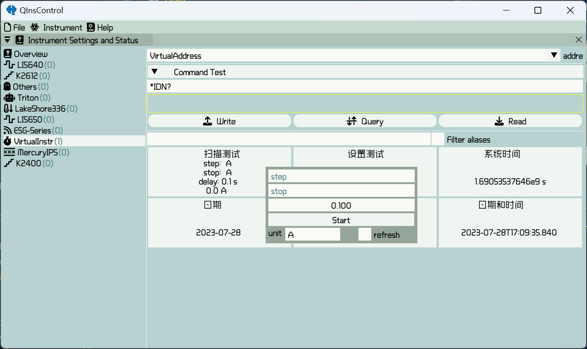

## set
For the settable variables, it can be set by the given value through inputing or simply clicking on a pre-defined optional 
value.

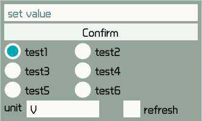

## read
For the readable variables, it can be only queried.


All these variables support selecting unit and whether it will auto update the state itself. With
auto-update enabled the reading runs in the background, so the UI never blocks on an instrument.
Instrument I/O is multi-threaded: every read / write / query is executed on a worker thread with a
per-quantity configurable write / read timeout, and failures are reported as toasts and in the
logger (see [Utilities](#utilities)).

# Data Acquiring

Clicking the DAQ entry on the left toolbar of the main window to do data acquiring

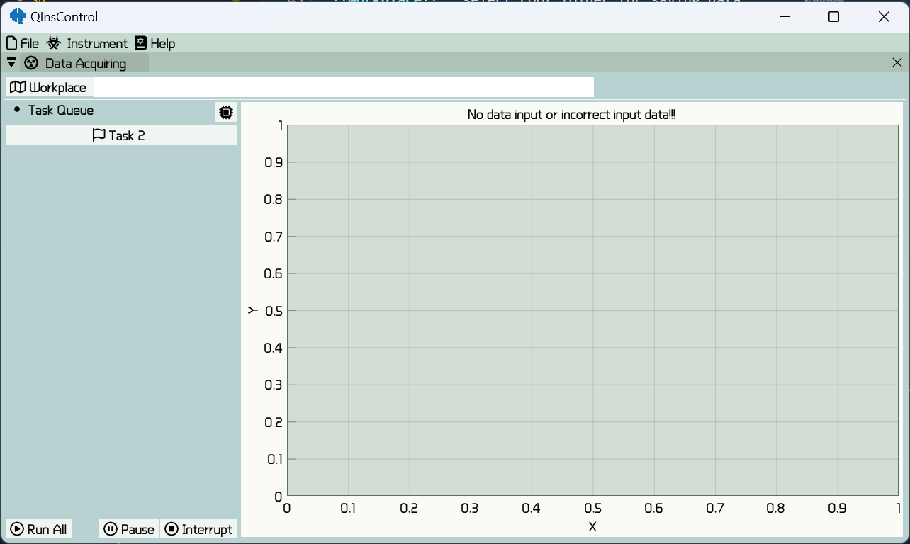

**Workplace** : select root folder for saving data. Data will be stored as
```
root folder/year/month/day/[time] task name.qdt
```
**Task 1** : represent a task script to aquire data. One can click it to edit the script or right click for more options
(Run / Cancel, Edit Script, Copy / Save / Load Script, Rename, Delete).

**Task groups** : tasks can be organized into folders. Right-click a group to rename it, delete it
or move its tasks back to the top level. Dragging follows the script editor logic: dropping a task
on another task inserts it right before it — after it when the dragged task already sits directly
in front of the target, so adjacent tasks can be swapped — and dropping onto a task inside a group
drags it directly into the group. Dropping a task on a group header inserts it before the group;
hold `Ctrl` while dropping on a group header to append it to that group. Groups are reordered the
same way: dropping a group on a task or another group inserts it at that position.

**microchip** : click it to edit circuit for recording measurement configuration.

**New Task / New Plot** : create a new task or plot; right-clicking on a blank region offers the
same plus groups, paste and project actions.

**Run All** : run all the available tasks in a top-down order

**Pause** : suspend the running task

**Interrupt** : stop the running task

While a task runs, each task shows a progress bar with step count, elapsed time and ETA, and data
is autosaved continuously. When a file exceeds the size configured in **Preferences** it is
automatically split into `[time] task name [n].qdt` files.

## Edit circuit
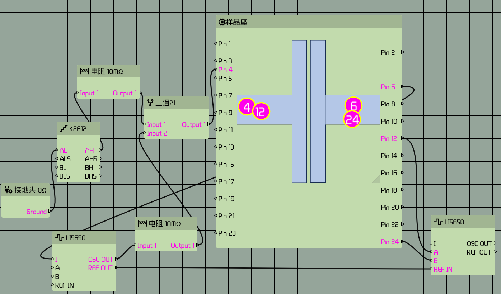
QInsControl provides a simple record manner for circuit in an experiment. For a samplebase, one can right click to load a sample image and then add some pins to match the real configuration and these pins can be dragged to the position in demand. For other nodes, one can easily right click to add or modify to satisfy the specified requirements. The editor supports undo / redo (`Ctrl+Z` / `Ctrl+Y`), a minimap and link menus.

## Edit script
For writing a script with convenience and universality, QInsControl provides several blocks to do this. In general, it is easy to writing an available script with only SweepBlocks and ReadingBlocks. For example

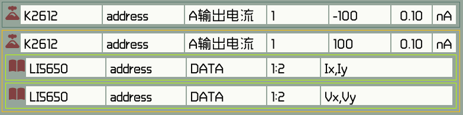

Here, I drive **A输出电流** of a **K2612** with address **address** (not specified) from its present value to -100 nA with a step 1 nA and a delay 0.1 s. Then, with the same method I drive it to 100 nA. In this process, for each value I drived to I get a reading from two **LI5650** with different address (not specified here). One datum of **DATA** is in the form of "data1,data2" which can be indexed by **1:2** and assigned to two keys **Ix** and **Iy** (or **Vx** and **Vy**). By the way, two ReadingBlocks with green borders means annotation **@async** for faster reading.

The task editor can switch between **block mode** and **text mode**. Block mode is better for
selecting instruments, addresses and quantities; text mode is better for reading and copying codes,
and the two modes are convertible from each other. Only block mode can be compiled into executable
tasks and run. A **HOLD** checkbox keeps the editor open while running, and an **Edit / View**
checkbox switches between editing and read-only modes.

### CodeBlock


It can be input with any julia codes. It is helpful when dealing with complicated relation between variables and it
supports all the grammar of julia language.

### StrideCodeBlock


It is similar to CodeBlock, but it can only be input a block title codes such as *for end*, *begin end*, *function end* and
so on. It is used to combine block codes in julia with other blocks in QInsControl. Middle click on its icon disables its handler which is used for pausing and interrupting.

### BranchBlock


It is only used inside a StrideCodeBlock to be complete. For example, it can be filled with *else*, *catch* and so on.

### SweepBlock


It is used to sweep a sweepable quantity. One can click to select the specific instrument, address and quantity and input step, destination and delay. A sweepable quantity is generally dimensioned and one have to make sure that a 
correct unit is selected. The destination accepts the form `start->stop` with two steps
`step1,step2` to sweep to an intermediate point first and then to the final value, and the inner
blocks are executed at every step of the sweep.

### FreeSweepBlock


It sweeps a readable quantity until a condition is reached instead of a fixed number of steps: one
selects the instrument, address and quantity, a mode `=`, `<` or `>` together with a target value,
a tolerance `delta`, a maximal `duration` and the `delay` between steps. The inner blocks are
executed after every reading until the condition holds or the duration is used up. This is useful
for e.g. waiting until a temperature stabilizes.

### SettingBlock


Similar to SweepBlock but for a settable quantity (a sweepable quantity is also a settable quantity). One can input a
string or a number dependent on the unit. When unit type is none, it only supports a string input and a "$" symbol is
able to be used to interpolate like in julia. Moreover, middle click at region of set value will open an optional values list for convenience.

### ReadingBlock


*Index* is used to split the data by ",". When data do not include delimiter, leave it blank. *mark* is used to name the 
recorded data. When data format includes delimiter, one can use "," to seperate multiple marks which is also unnecessary.

### WriteBlock


Input the command and write to the specified instrument.

### QueryBlock


Input the command and query the specified instrument.

### ReadBlock


Read the specified instrument.

### FeedbackBlock

It performs an action on the selected instrument without I/O. Available actions are **Pause**,
**Interrupt** and **Continue**, which control a running DAQ task from inside a script, e.g. to
pause the task until the user resumes it.

### Removed blocks

The former **LogBlock** and **SaveBlock** have been removed; please use
```julia
@saveblock key var # or @saveblock var
```
in a CodeBlock instead. Instrument states are logged automatically before and after a script runs;
to snapshot them mid-run, call `logblock()`.

## macros in scripts

Besides plain Julia, the following macros are available inside CodeBlocks:

- `@progress for i in 1:n` — show a progress bar for the loop; `@progress mark for ...` uses a
  custom mark as the label.
- `@progress observables getdata stop duration while cond` — the progress-bar form used by
  FreeSweepBlock, updating while `cond` holds.
- `@saveblock key var` (or `@saveblock var`) — store a variable of the script context into the
  saved file.
- `@psleep seconds` — sleep that keeps the UI responsive and can be interrupted by
  pause / interrupt.

Plain helper functions are also available: `logblock()` snapshots all instrument states into the
record, `newfile("name")` transparently switches to a new data file mid-run, and
`timeaverage(data, τ)` / `isarrived(data, target, δ, τ)` provide averaged readings and convergence
checks for waiting loops.

Blocks compile to plain Julia: SweepBlocks become `@progress for ...` loops, and `@async`-annotated
blocks are wrapped in `@sync` automatically, so the generated text mode code is always readable and
copyable.

## note
All the blocks that bind to a specified instrument can be middle clicked to enter catch mode. In this mode, the icon is 
red and the data obtained will be a "" when an error occurs. For ReadingBlock, QueryBlock and ReadBlock, middle clicking
at the region used to input marks will change the mode from normal to observable to observable and readable. In 
observable mode, the mark region is cyan and the obtained data will be stored in a variable named by the input marks
and will not be stored in file. In observable and readable region, the mark region is red, all same as observable mode
but the obtained data will stored in file. For ReadingBlock, WriteBlock, QueryBlock and ReadBlock, clicking on the block
border will enter the async mode. In this mode, block border is green and the generated codes will be marked by @async,
this almost always speeds up the measurement.
Different mode has different color indicator which can be found in the style editor (**Preferences** -> **Style** -> **More Style**). Furthermore, this editor supports dragging to reorder blocks and a Ctrl down to dragging a block into a StrideCodeBlock or SweepBlock.

## Example
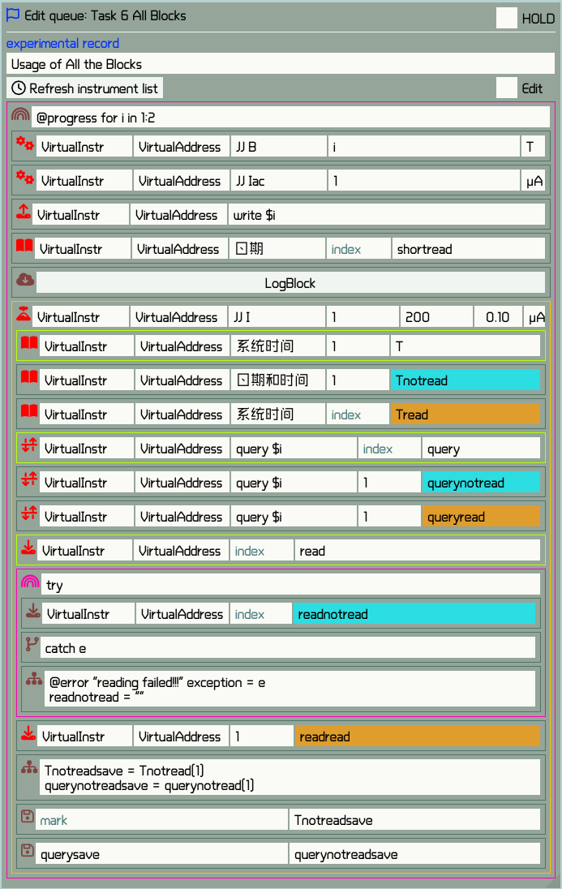

This panel includes a title of the editing task, a **HOLD** checkbox to set the panel no-close when selected, an inputable
region to record something necessary, a button **Refresh Instrument list** with the same functionality as previous menu, an **Edit** or 
**View** checkbox to change the editing mode and finally a region to write your own script.

This script includes two loop structures. The outter one is constructed by a StrideCodeBlock with code
```julia
@progress for i in 1:2
```
on it. The macro @progress is used to show a progressbar. The inner one is constructed by a SweepBlock. It relates to
the instrument VirtualInstr with address VirtualAddress, variable **JJ I**, step 1 μA, destination 200 μA and delay 
0.1s for each loop.

In general, it is unnecessary to write such a complicated script. Most of them are used to support special demands and ensure universality.

# Plot Data

## select a plot
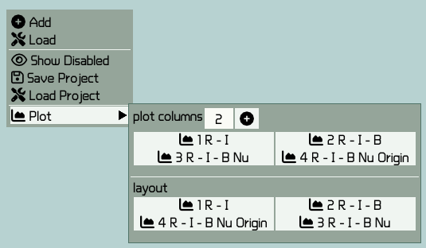

One can right click at blank region to select plots to show. Plots are organized in a tree with
groups and follow the same dragging logic as tasks: drop on a plot to insert before it (also
inside groups), drop on a group header to insert before the group, and hold `Ctrl` while dropping
on a group header to append the plot to that group.

## select data for a plot
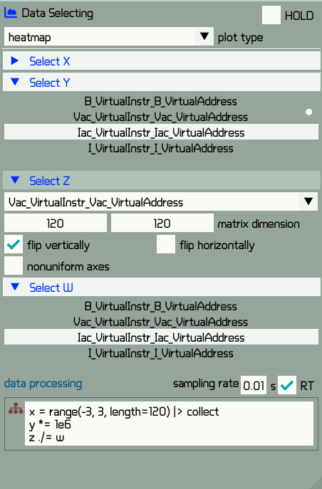

Right-click a plot and choose **Select Data** to open the data selecting window. The data used to
plot includes four dimensions X Y Z W. X Y Z is regular dimensions and W is used to be calculated with others, and
several **AUX** dimensions can be added and fed into the processing functions. Each dimension
selects a data key of the file and a number / text type. To plot a heatmap, a matrix is necessay but the stored data format is as a vector so that it has to be specified
the dimensions of the Z plotting matrix and reverse it in dimension 1 or 2.

At the bottom region, one can do some simple data processing. Three Julia functions can be edited:

```julia
function process(x, y, z, w, aux...)    # returns the processed data to plot
function process!(figure, x, y, z, w)   # modify the figure before plotting
function plot!(figure, x, y, z, w)      # custom plotting into the figure
```

and the selected data are bound to variables `x`, `ys`, `z`, `ws`. For Y and W dimension, they relate to
variables `ys` and `ws` respectively and can be accessed by index. For convenience, `ys[1]` and `ws[1]` are simply `y` and `w`.

Data can be updated manually with the **Update** button or continuously with the real-time switch
during a DAQ run, and a sampling rate limits the update frequency. Series can be copied, pasted and
deleted; the **Figure Layout** section controls the plot layout.

One can middle click or right click at plot region to find more options.

# Data Reviewing

Click **Open File** (`Ctrl+O`) or **Open Folder** (`Ctrl+K`) to open saved data. Opened files and
folders are also collected in the **Files** page of the main window, where each entry can be shown,
closed or refreshed again.

## file browsing
The file browser shows a folder as a tree with a text filter and a "valid only" toggle that hides
unfinished or invalid files; clicking a file opens it in the data viewer. Right-click a file to
export or delete it. Use the refresh button to pick up new files written by a running DAQ.

## the data viewer
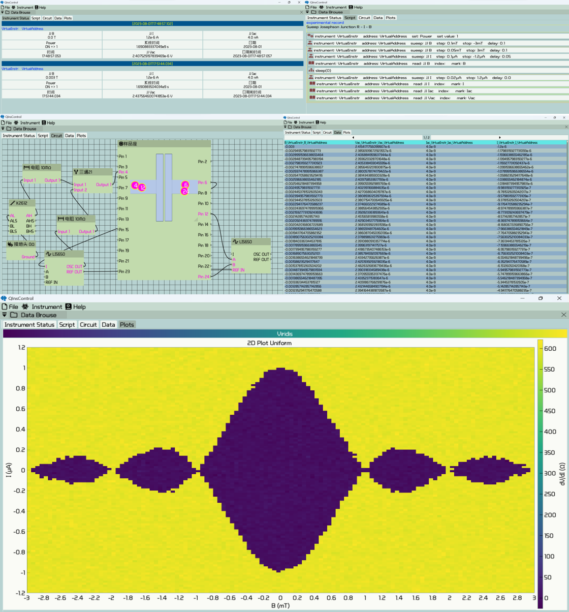

One can review the content stored in the file which includes the states of instruments, the actions,
the script, the circuit, the data and the plots. The data tab shows a paginated table that can be
resized and reordered, and plots can be modified through the context menu of the plots tab bar.
Right-clicking the tab bar also offers exporting the data as CSV.

## the data formatter
For batch processing, the data formatter collects several files into groups which can be merged or
exported with an index-prefixed name, replays the recorded scripts and applies user-defined Julia
code blocks. Rows can be reordered by dragging, and each row has toggles for visibility and export.

## the saved data file

Data files are plain [JLD2](https://github.com/JuliaIO/JLD2.jl) files, so they can also be read
outside the GUI. The top-level entries are

| entry              | content                                                              |
|:-------------------|:---------------------------------------------------------------------|
| `data`             | dict of data key to vector of readings (strings or parsed numbers, see below) |
| `circuit`          | the recorded circuit                                                  |
| `daqdataplots`     | the plots defined for the file                                        |
| `info`             | file information (task name, workplace, timestamps, ...)              |
| `valid`            | whether the task finished normally (`true` / `false`)                 |
| other entries      | instrument states and actions logged before / during / after the run, the task script, `@saveblock`-saved variables |

By default readings are stored as strings exactly as received from the instrument; changing
**Data Type** in the DAQ preferences parses them into numbers (e.g. `Float64`) at save time —
unparseable values keep their string form. Reading the data column in plain Julia is simply

```julia
using JLD2
data = JLD2.load("path/to/[2026-09-12 10.00.00] Task 1.qdt")["data"]
```

While a task runs, incoming data is buffered into a `.qdt.cache` file and the configuration into a
`.cfg.cache` file next to the data file, so a crash never loses more than one autosave interval
(configurable **Save Time**). When a file grows beyond the configured size it is closed and
continued as `[time] task name [2].qdt`, `[3].qdt` and so on; the viewer treats the sequence as one
task.

# Project

All elements above together make up one project. One can save and load a project (tasks, scripts,
circuits and plots) to conveniently reuse them. Loading is blocked while a DAQ task is running.
Old project files are migrated automatically. One example file
[demo.daq](https://github.com/FaresX/QInsControl.jl/tree/master/example) can be found in example folder.

# Remote Mode (QIC)

Two QInsControl instances can communicate with each other through the QIC protocol, which turns one
installation into the **server** that owns the real instruments and another one into a **client**
that uses them as if they were local — useful e.g. for logging instrument states from a second
computer while the first one is acquiring.

## the server

Open the **Server Monitor** from the Instruments page of the main window. It offers the listening
**port** (default 6060), the maximal number of clients and the controller buffer size, and a
**Running / Stopped** toggle that starts or stops the server. While running, connected clients are
listed in a table with their IP address and port, and a **Fast / Slow Mode** switch trades CPU cost
for latency.

## the client

On the client side, add the server as if it were an instrument: the address is

```
[server address]::QIC::[instrument address]
```

e.g. `TCPSOCKET::127.0.0.1::6060::QIC::SERIAL::COM1` controls the serial instrument connected to
the server. All communication is forwarded through the server — including the `*IDN?` query — and
the remote instrument is matched against the client's own instrument registrations, so its
quantities, controls and widgets behave exactly like local ones. Auto-detection works through QIC
as well: it discovers the instruments connected to the server.

# Utilities

## Preferences

The **Preferences** window collects all persistent settings (saved as `conf.toml` next to the
assets):

- **Basic** — event handling and lowest framerate (lower saves CPU, higher smooths animations),
  multi-viewport and main-window pinning, window size, OpenGL version, worker threads, file
  encoding, external text editor and the UI language (English / 中文).
- **Communication** — path of the NI-VISA library and per-instrument communication attributes.
- **Data Viewer** — how many rows are previewed.
- **DAQ** — data save type (string or numeric), autosave interval, file splitting size, buffer and
  channel sizes, history length and instrument retry counts.
- **Instrument buffers** — auto-refresh behaviour, help tooltips and column layout of the
  instrument control windows.
- **Server** — QIC port, maximal clients and buffer size.
- **Console / Logs** — output directories, refresh rates and how many lines are kept in view.
- **Common addresses** — a list of frequently used instrument addresses offered by the manual-add
  context menu.
- **Styles** — the style directory and the default style name.
- **Units** — editable unit-type definitions (e.g. add a new unit to the `V` family) used by every
  quantity.

## keyboard shortcuts

- `Ctrl+O` — open file(s); `Ctrl+K` — open a folder.
- `Ctrl+Enter` — send a command from the console input line.
- `Ctrl+Z` / `Ctrl+Y` — undo / redo in the circuit editor and in code editors.
- The built-in code editor additionally supports standard editing keys: select-all, clipboard,
  word-wise movement with the arrows, `Home` / `End` and page scrolling.

## logger and console

- **Logger** — shows the day's log file as a color-coded table with severity filters; double-click
  an entry to expand it and toggle stacktraces.
- **Console** — mirrors the program output and accepts Julia commands with an input history
  (`Ctrl+Enter` to send).

## style editor

Every color and style variable of the GUI can be edited in the style editor: the ImGui and node
editor styles, the extra application colors, the FontAwesome icon mapping and variables like font
path and size, UI scale, icon sizes, toast duration and per-window wallpapers. Styles can be saved
under a name (they are stored as .toml files in the style directory), set as default and shared
between users; Makie themes can be applied to keep plots consistent with the UI theme.
